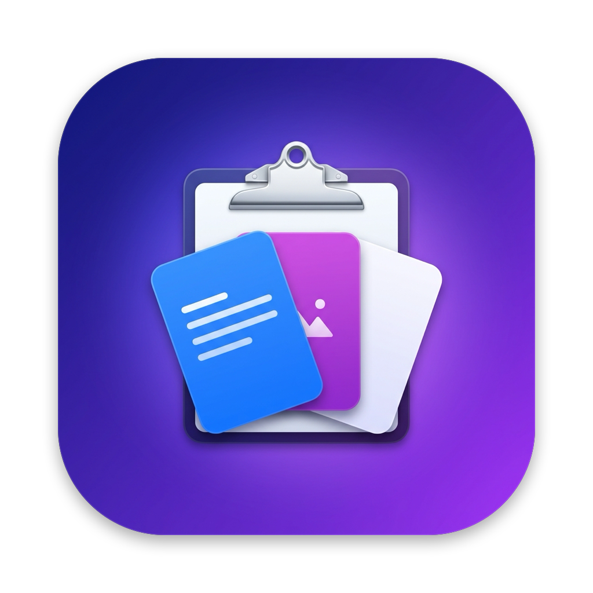

<p align="center">
  
</p>

# ClipPaste

Histórico da área de transferência para macOS, nativo e leve. Escrito em Swift 6 com SwiftUI e AppKit.

Aperte **⇧⌘V** e um painel com os itens copiados abre na parte de baixo da tela. Arraste um card para qualquer campo de texto, documento ou app.

## Recursos

- **Texto e imagem**: guarda tudo o que você copia, com miniatura das imagens.
- **Arrastar e soltar**: o painel não rouba o foco do app em que você está, então dá para soltar o card direto no campo.
- **Busca**: filtra os textos do histórico, sem diferenciar maiúsculas nem acentos.
- **Fixar itens**: clique com o botão direito em um card e escolha **Fixar**. Itens fixados aparecem primeiro e não são apagados pelo limite do histórico.
- **Origem**: cada card mostra o ícone do app de onde o conteúdo foi copiado.
- **Atalho configurável**: dá para trocar pelo menu da barra de status, em **Mudar atalho…**.
- **Privacidade**: ignora conteúdo marcado como sensível ou temporário (por exemplo, senhas de gerenciadores) e tudo fica salvo só no seu Mac.
- **Nenhuma permissão necessária**: não pede Acessibilidade nem qualquer outra autorização do sistema.
- **Zero dependências**: usa só AppKit, SwiftUI, Carbon e Foundation.

## Instalação

**Requisitos:** macOS 14 (Sonoma) ou posterior e um Mac com Apple Silicon (M1 ou mais novo).

### Opção 1: baixar o app (recomendado)

1. Abra a página de [Releases](https://github.com/BigDevEdu/OpenClipPaste/releases/latest) e baixe o arquivo `ClipPaste-<versão>-macos-arm64.zip`.
2. Dê dois cliques no `.zip` para descompactar. O macOS cria o `ClipPaste.app`.
3. Arraste o `ClipPaste.app` para a pasta **Aplicativos** (`/Applications`).
4. Libere o app no Gatekeeper (veja abaixo). Isso só é preciso na primeira vez.
5. Abra o ClipPaste pela pasta Aplicativos, pelo Launchpad ou pelo Spotlight (⌘ Espaço → "ClipPaste").

#### Liberar o app na primeira abertura

O ClipPaste não é notarizado pela Apple, então na primeira abertura o macOS avisa que não pode verificar o desenvolvedor. Escolha **uma** das formas abaixo para liberar:

- **Pelo Terminal** (mais rápido):

  ```bash
  xattr -dr com.apple.quarantine /Applications/ClipPaste.app
  ```

- **Pelos Ajustes do Sistema**: tente abrir o app uma vez e feche o aviso. Depois vá em **Ajustes do Sistema → Privacidade e Segurança**, role até o fim e clique em **Abrir Mesmo Assim** ao lado de "ClipPaste". Confirme com sua senha.
- **No macOS 14 (Sonoma)** também funciona clicar com o botão direito no app → **Abrir** → **Abrir**.

### Opção 2: instalar pelo Terminal

Baixa a versão mais recente, instala em `/Applications` e já libera o app:

```bash
URL=$(curl -fsSL https://api.github.com/repos/BigDevEdu/OpenClipPaste/releases/latest \
  | grep -o '"browser_download_url": *"[^"]*\.zip"' | cut -d '"' -f4)
curl -fL "$URL" -o /tmp/ClipPaste.zip
ditto -x -k /tmp/ClipPaste.zip /Applications
xattr -dr com.apple.quarantine /Applications/ClipPaste.app
rm /tmp/ClipPaste.zip
open /Applications/ClipPaste.app
```

### Opção 3: compilar a partir do código

Precisa das Command Line Tools (`xcode-select --install`).

```bash
git clone https://github.com/BigDevEdu/OpenClipPaste.git
cd OpenClipPaste
./scripts/bundle.sh
cp -R build/ClipPaste.app /Applications/
open /Applications/ClipPaste.app
```

Um app compilado na sua própria máquina não fica em quarentena, então não precisa liberar no Gatekeeper.

### Primeiro uso

- O ClipPaste não abre janela nem aparece no Dock. Um ícone de **prancheta** aparece na barra de menus, perto do relógio.
- Copie algo (⌘C) e aperte **⇧⌘V**: o painel com o histórico abre na parte de baixo da tela.
- Nenhuma permissão é pedida. Se o macOS pedir alguma, não é do ClipPaste.

### Abrir automaticamente ao ligar o Mac

1. Abra **Ajustes do Sistema → Geral → Itens de Início**.
2. Em **Abrir ao Iniciar Sessão**, clique em **+**.
3. Escolha **ClipPaste** na pasta Aplicativos e clique em **Abrir**.

### Atualizar

1. Feche o ClipPaste: ícone na barra de menus → **Sair**.
2. Repita a instalação (Opção 1, 2 ou 3) e substitua o app antigo em Aplicativos.

O histórico é mantido, porque ele fica salvo fora do app.

### Desinstalar

1. Feche o ClipPaste: ícone na barra de menus → **Sair**.
2. Se tiver adicionado, remova-o de **Ajustes do Sistema → Geral → Itens de Início**.
3. Apague o app e o histórico:

   ```bash
   rm -rf /Applications/ClipPaste.app
   rm -rf ~/Library/Application\ Support/ClipPaste
   ```

## Desenvolvimento

- macOS 14 (Sonoma) ou posterior
- Swift 6: basta ter as Command Line Tools instaladas (`xcode-select --install`). O Xcode não é necessário.

## Como compilar e rodar

```bash
swift build          # build de debug
swift run            # roda sem gerar o .app
swift test           # roda os testes
```

### Gerar o app

```bash
./scripts/bundle.sh
```

Isso gera `build/ClipPaste.app`: build de release para arm64, com assinatura ad-hoc. Para instalar, mova o app para `/Applications`.

> O ClipPaste roda como app de barra de menus (`LSUIElement`). Ele não aparece no Dock, só como ícone de prancheta na barra de status.

### Publicar uma release

O workflow [`release.yml`](.github/workflows/release.yml) roda sozinho quando uma tag `v*` é enviada:

```bash
git tag v1.0.0
git push origin v1.0.0
```

Ele roda os testes, gera o app com a versão da tag aplicada no `Info.plist` e cria o GitHub Release com o `.zip` e o checksum SHA-256 anexados. Também dá para rodar manualmente pela aba **Actions**: nesse caso ele só gera o `.zip` como artefato da execução, sem criar release.

## Uso

| Ação | Como |
| --- | --- |
| Abrir/fechar o painel | **⇧⌘V** (ou **Abrir** no menu da barra de status) |
| Colar um item | Arraste o card até o destino |
| Buscar | Digite no campo **Buscar** |
| Limpar a busca / fechar | **Esc** |
| Fixar / desafixar | Botão direito no card → **Fixar** |
| Trocar o atalho | Menu da barra de status → **Mudar atalho…** |
| Apagar o histórico | Menu da barra de status → **Limpar histórico** |

## Armazenamento

O histórico fica em:

```
~/Library/Application Support/ClipPaste/
├── index.json     # metadados dos itens
└── blobs/*.png    # imagens copiadas
```

São guardados no máximo **200 itens não fixados**. Quando passa disso, os mais antigos saem primeiro.

## Estrutura do projeto

```
Sources/ClipPaste/
├── ClipPasteApp.swift      # entrada do app, AppDelegate e menu da barra de status
├── ClipboardMonitor.swift  # verifica o NSPasteboard (changeCount) periodicamente
├── HistoryStore.swift      # histórico, persistência e limite de itens
├── ClipItem.swift          # modelo de um item (texto/imagem)
├── HotKey.swift            # atalho global via Carbon RegisterEventHotKey
└── Panel.swift             # NSPanel não ativável e a interface SwiftUI dos cards
Tests/ClipPasteTests/       # testes do HistoryStore
Resources/
├── Info.plist              # Info.plist do bundle
├── AppIcon-source.jpg      # arte original do ícone (quadrada, sem cantos)
├── AppIcon.png             # ícone final 1024×1024 com máscara e sombra
└── AppIcon.icns            # ícone usado pelo app
scripts/
├── bundle.sh               # gera o ClipPaste.app
├── make-icon.sh            # gera AppIcon.png e AppIcon.icns a partir da arte
└── make_icon.swift         # aplica a máscara e a sombra do macOS na arte
```

### Trocar o ícone

Substitua `Resources/AppIcon-source.jpg` por uma arte quadrada de 1024×1024 sem cantos arredondados e rode:

```bash
./scripts/make-icon.sh
```

O script recorta a arte no formato de ícone do macOS, aplica a sombra e gera o `AppIcon.icns` com todos os tamanhos.

## Notas técnicas

- O painel é um `NSPanel` com `.nonactivatingPanel`. Ele não pode virar o app ativo, senão o arrastar e soltar para o app de destino deixa de funcionar.
- O macOS não avisa quando a área de transferência muda, então o app verifica `NSPasteboard.changeCount` a cada 0,5 s. Arquivos copiados no Finder (`fileURL`) são ignorados.
- O atalho global usa a API Carbon `RegisterEventHotKey`, que não exige permissão de Acessibilidade.
